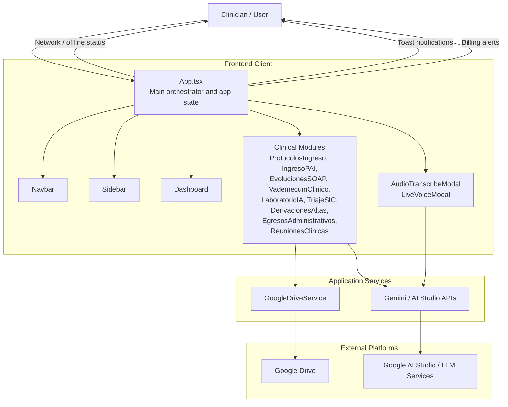

# Architecture Overview

This application is a React + TypeScript clinical workflow dashboard for COSAM Rinconada, organized as a modular single-page application with a central orchestrator and feature-specific modules.

## Layering summary

- Presentation layer: React components such as `Navbar`, `Sidebar`, `Dashboard`, and individual clinical modules.
- App orchestration layer: `App.tsx` manages navigation, modal state, alerts, toasts, and drive/voice integrations.
- Service layer: `GoogleDriveService` handles drive connectivity; AI-powered features call Gemini/AI Studio APIs.
- External systems: Google Drive and AI Studio provide persistence and intelligence features.

## Core responsibilities

- Route between modules and render the active clinical workflow.
- Maintain global UI state for connection, toasts, billing warnings, and modals.
- Provide access to backup, transcription, and real-time voice features.
- Surface availability based on internet connectivity and prepayment credit status.
